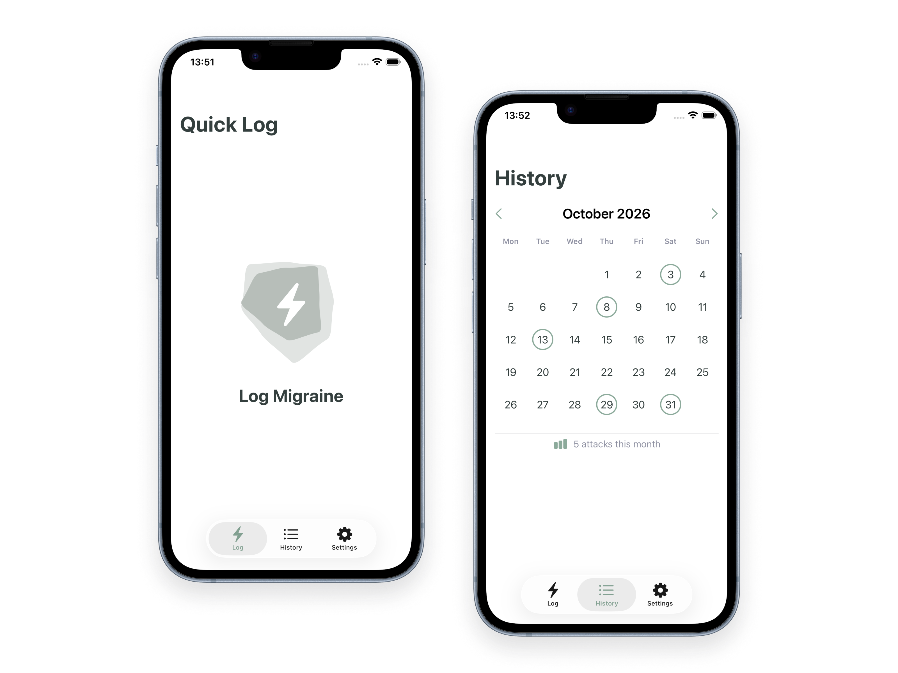

# Migraine Tracker

A personal iOS app prototype exploring how migraine tracking can require less effort, especially on days when recording symptoms feels like too much.

The idea is simple: **start with one tap, and make everything else optional.**

  

## The idea

Migraine tracking can be useful, but detailed forms can be a barrier precisely when someone is feeling unwell. I wanted to explore a calmer approach that prioritizes recording *something* over recording everything.

The project grew from a question: **How little can someone do and still have a useful record?**

## What the prototype explores

- **Quick Log:** Record a migraine with a single tap.
- **Optional details:** Add information such as severity, duration, symptoms, medication, and notes when it's helpful.
- **History:** Review recorded days in a calendar and revisit entries.
- **Tracking preferences:** Choose whether to be prompted for more details after a Quick Log.
- **Local storage:** Save entries on the device using a JSON-backed data store.

The core experience is intentionally lightweight. More detailed tracking is an option, not a requirement.

## Design approach

Three principles guide the project:

1. **Start with the minimum.** The first action should be easy even on a difficult day.
2. **Offer detail without demanding it.** Users can add context when they have the energy and interest.
3. **Show what was actually recorded.** Missing information should not be mistaken for a negative response.

There is an ongoing trade-off between simplicity and completeness. The prototype is an exploration of that balance, not a finished medical product.

## Built with

- Swift and SwiftUI
- Xcode
- Local JSON persistence
- AI-assisted development tools, used during prototyping and implementation

## Project status

**Work in progress / personal prototype.** The repository includes experiments and unfinished areas alongside the core logging experience. Some screens and settings are exploratory and should not be treated as completed features.

This app is not a medical device and is not intended to provide diagnosis or treatment advice.

## More about the project

The portfolio case study focuses on the product decisions, UX trade-offs, and design process behind the prototype.

[Read the case study](https://lndmr.github.io/projects/migraine-tracker.html)
